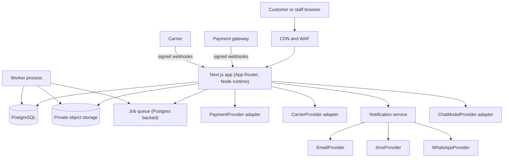
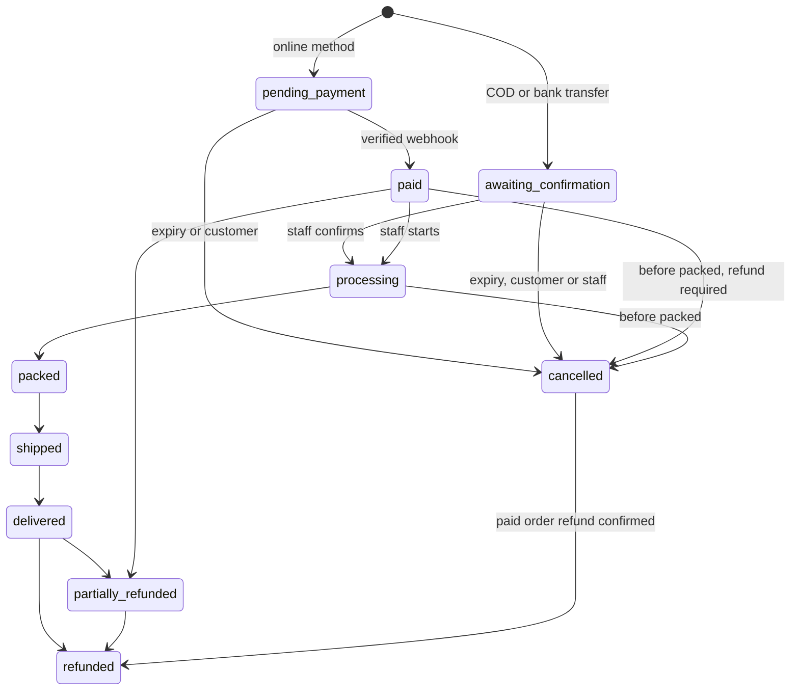
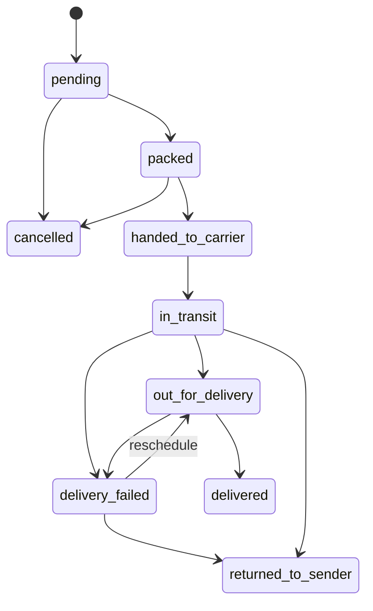
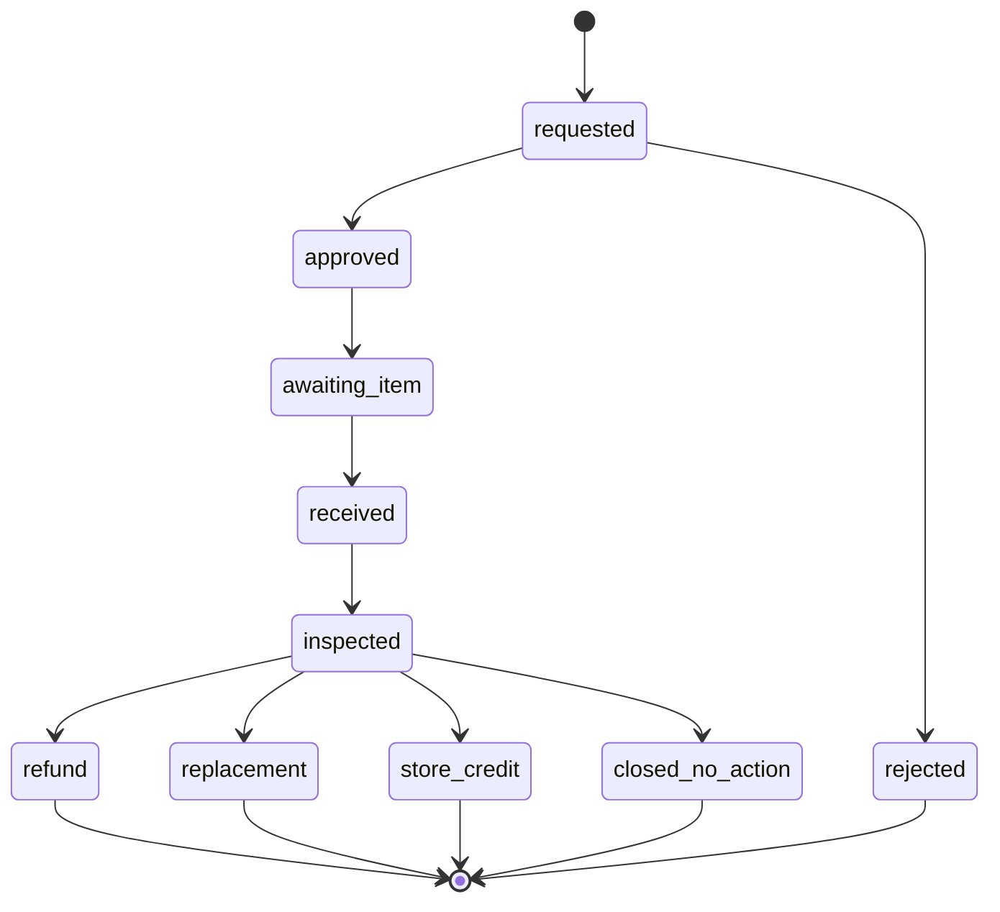
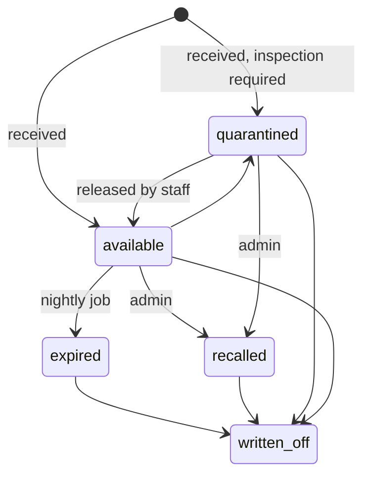

# Architecture

Status: Phase 0 draft. Nothing here is implemented. Changes to this design after approval need owner sign-off (rule 2).

## 1. System overview

Single deployable codebase with two processes from the same repository: the web app and a worker. One database. No microservices (decision D2).

## 2. Layering

Modules live under `src/modules/<domain>`. Each module has `schema` (Zod), `service` (business rules, no HTTP), `repo` (database access), and tests. Route handlers and server actions are thin: authenticate, authorise, validate, call a service.

Domains: `auth`, `rbac`, `audit`, `catalog`, `publishing`, `inventory`, `pricing`, `cart`, `checkout`, `payments`, `orders`, `shipping`, `returns`, `refunds`, `notifications`, `wishlist`, `reporting`, `chatbot`, `content`, `jobs`, `config`.

Rules:

- Only `pricing` computes money. No other module does arithmetic on prices.
- Only `inventory` writes the stock ledger.
- Only `orders` changes order state, through one transition function.
- Dependencies point downward: routes to services to repos. Modules talk to each other through exported service functions, never another module's tables.
- Lint rules (Phase 1) enforce the import boundaries.

## 3. Adapters

| Interface                                          | Implementations in scope                                                                       | Notes                                                                                                          |
| -------------------------------------------------- | ---------------------------------------------------------------------------------------------- | -------------------------------------------------------------------------------------------------------------- |
| `PaymentProvider`                                  | One real gateway (not yet named), `CashOnDelivery`, `BankTransfer` (order methods, no gateway) | Methods: create payment session, fetch payment (server to server), verify webhook, create refund, fetch refund |
| `CarrierProvider`                                  | `ManualDispatch` (always available), real carrier later                                        | Methods: create shipment, get label, track, cancel, verify webhook                                             |
| `EmailProvider`, `SmsProvider`, `WhatsAppProvider` | Provider chosen by owner                                                                       | One `NotificationService` applies preferences, quiet hours, suppression, templates, delivery log               |
| `ChatModelProvider`                                | Anthropic Claude                                                                               | Model name and limits from environment                                                                         |
| `ObjectStorage`                                    | S3 compatible private bucket                                                                   | Signed URLs, short expiry                                                                                      |
| `BotChallenge`                                     | Turnstile                                                                                      | See conflict C2                                                                                                |

Each adapter has a fake implementation used only in tests, located in a `testing` folder that production builds exclude.

## 4. Key flows

### Checkout and payment

1. Client sends variant IDs, quantities, coupon code, address. Never prices.
2. Server runs `pricing.quote()`, checks restricted rules, checks expiry shelf life, reserves stock with row locks, writes a pending order with an immutable snapshot.
3. For gateway methods, the customer is sent to the hosted payment page.
4. Gateway calls the webhook. The handler verifies the signature on the raw body, checks timestamp tolerance, checks event ID uniqueness, matches amount, currency, and order reference, then calls the order transition to "paid".
5. A browser redirect only shows a status page that reads the order state. It never changes state.
6. Totals are recomputed at cart view, submission, and payment confirmation. A difference stops checkout and shows the change.

### Stock

Stock moves only through the append only `stock_ledger`. Batch counters (`on_hand`, `reserved`, `quarantined`) are updated in the same transaction. Database check constraints prevent negatives. Allocation picks batches by earliest expiry among available batches that satisfy the shelf life rule, locking rows with `SELECT ... FOR UPDATE SKIP LOCKED` ordered by expiry, falling back to waiting only when nothing else qualifies (design detail finalised in Phase 2, with a concurrency test for the last unit).

## 5. State machines

### Order

Notes: cancellation by the customer is allowed up to "processing" and not from "packed" (config cut-off may move this). "packed" cancellations are staff only with a reason code. Every transition stores actor, reason, time, and previous state, and enqueues a notification. Illegal transitions throw and are tested through a full transition table test (every state pair).

### Shipment

### Return (RMA)

Returned agrochemical and seed stock enters `quarantined` under its original batch. Only a staff action releases it or writes it off.

### Batch

A recalled batch cannot return to available. Whether newly received stock starts as available or quarantined is a config switch.

## 6. Background jobs

All jobs run in the worker, log each run to `job_runs` (start, end, outcome, counts), retry with backoff, and alert on failure.

| Job                      | Schedule         | Purpose                                               |
| ------------------------ | ---------------- | ----------------------------------------------------- |
| `reservation_expiry`     | every minute     | Release expired stock reservations through the ledger |
| `batch_expiry_check`     | nightly          | Flag near expiry, set expired batches to expired      |
| `notification_dispatch`  | every minute     | Deliver and retry queued messages                     |
| `payment_reconciliation` | daily            | Compare gateway records with orders, flag differences |
| `carrier_poll`           | every 30 minutes | Polling fallback for tracking                         |
| `backup`                 | nightly          | Encrypted database dump to separate storage           |
| `retention_cleanup`      | nightly          | Delete data past its retention period                 |
| `alert_digest`           | hourly           | Low stock, near expiry, reservation failures          |
| `bank_transfer_expiry`   | hourly           | Cancel unpaid bank transfer orders                    |

## 7. Environments

Local, CI (ephemeral database), staging, production. Separate secrets, databases, buckets, and gateway test or live keys. Staging uses only test fixtures from the labelled fixtures script. Production starts empty.

## 8. Key decisions

Each has a record in `docs/decisions/`.

| ID  | Decision                                  | Reason                                                                                                                            |
| --- | ----------------------------------------- | --------------------------------------------------------------------------------------------------------------------------------- |
| D1  | Next.js App Router with TypeScript strict | Required stack, server rendering keeps pages light                                                                                |
| D2  | Modular monolith plus one worker          | One team, simple operations, transactional stock and order logic needs one database                                               |
| D3  | Postgres backed queue                     | No extra infrastructure, jobs share transactions with business writes                                                             |
| D4  | Drizzle over Prisma (proposed)            | SQL visible, row locking and check constraints expressed directly. Final choice confirmed in Phase 1 after reading installed docs |
| D5  | Integer minor units for money             | No floating point rounding errors                                                                                                 |
| D6  | Server side sessions in Postgres          | Revocation, no tokens in browser storage                                                                                          |
| D7  | Append only ledger and audit log          | Traceability. Enforced with revoked UPDATE and DELETE privileges plus triggers                                                    |
| D8  | Hosted payment page                       | Keeps card data out of scope (SAQ A)                                                                                              |
