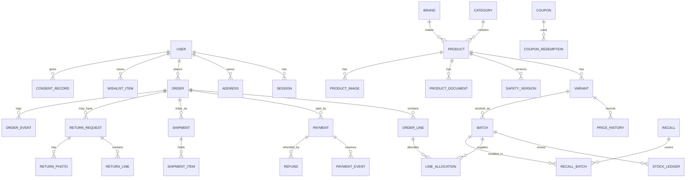

# Database design (draft)

Status: Phase 0 draft. The table level dictionary below lists purpose and key columns. The full column by column dictionary (type, constraint, purpose) is completed in the phase that creates each table, in the same pull request as the migration.

Conventions: UUID primary keys (v7 for ordering), `created_at` and `updated_at` as `timestamptz` stored in UTC, money as `bigint` minor units with a `currency` column (ISO 4217), no floats for money or quantities of stock, enums as Postgres enums or check constrained text.

## Entity relationship diagram (core)

## Table dictionary (draft)

### Identity and access

| Table             | Purpose                              | Key columns                                                                                           |
| ----------------- | ------------------------------------ | ----------------------------------------------------------------------------------------------------- |
| `users`           | Customers and staff                  | email (unique, normalised), password_hash (Argon2id), role, status, locale, mfa_enrolled_at           |
| `sessions`        | Server side sessions                 | id_hash, user_id, kind (customer or staff), created_at, last_seen_at, absolute_expires_at, revoked_at |
| `mfa_credentials` | TOTP secret (encrypted) and passkeys | user_id, type, secret_enc, credential_id, counter                                                     |
| `auth_tokens`     | Reset and verification tokens        | token_hash, purpose, user_id, expires_at, used_at                                                     |
| `login_attempts`  | Throttling and security alerts       | key_hash, outcome, at                                                                                 |
| `audit_log`       | Immutable admin action log           | actor_id, action, entity, entity_id, before, after, ip_hash, user_agent, at                           |

### Catalog

| Table                                                     | Purpose                                        | Key columns                                                                                                                                                                                                                 |
| --------------------------------------------------------- | ---------------------------------------------- | --------------------------------------------------------------------------------------------------------------------------------------------------------------------------------------------------------------------------- |
| `categories`                                              | Editable tree                                  | parent_id, slug, name_key, position                                                                                                                                                                                         |
| `brands`, `manufacturers`                                 | Reference data                                 | name, country                                                                                                                                                                                                               |
| `crops`, `targets`                                        | Label crops and pests, weeds                   | name, kind                                                                                                                                                                                                                  |
| `active_ingredients`                                      | Reference                                      | name                                                                                                                                                                                                                        |
| `products`                                                | Product head                                   | category_id, brand_id, class (seed, fertiliser, nutrient, pesticide, tool), status (draft, in_review, published, archived), authored_by, published_by, country_of_origin                                                    |
| `variants`                                                | Pack sizes, SKU                                | product_id, sku, pack_size, unit, status                                                                                                                                                                                    |
| `price_history`                                           | Every price ever set                           | variant_id, amount_minor, currency, valid_from, valid_to                                                                                                                                                                    |
| `safety_versions`                                         | Versioned safety critical fields               | product_id, version, label_text, application_rate, pre_harvest_interval, reentry_interval, hazard_class, signal_word, registration_number, first_aid, storage, restricted_use, authored_by, approved_by, approved_at, state |
| `product_documents`                                       | Label PDF, SDS                                 | product_id, safety_version_id, kind, storage_key, sha256                                                                                                                                                                    |
| `product_images`                                          | Real images                                    | product_id, storage_key, source, permission_note, width, height                                                                                                                                                             |
| `seed_details`, `fertiliser_details`, `pesticide_details` | Class specific fields                          | product_id and class fields                                                                                                                                                                                                 |
| `product_crops`, `product_targets`, `product_ingredients` | Join tables with label concentration or rate   |                                                                                                                                                                                                                             |
| `search_queries`                                          | Searches with no result flag, no personal data | normalised_query, result_count, at                                                                                                                                                                                          |

### Inventory

| Table                                         | Purpose                    | Key columns                                                                                                                                                                                                      |
| --------------------------------------------- | -------------------------- | ---------------------------------------------------------------------------------------------------------------------------------------------------------------------------------------------------------------- |
| `suppliers`                                   | Batch sources              | name, contact                                                                                                                                                                                                    |
| `batches`                                     | Stock per lot              | variant_id, lot_number, supplier_id, manufactured_on, expires_on, received_qty, on_hand, reserved, quarantined, status. Checks: on_hand >= 0, reserved >= 0, quarantined >= 0, reserved + quarantined <= on_hand |
| `stock_ledger`                                | Append only movements      | batch_id, kind, quantity, actor_id, reason, order_id, at                                                                                                                                                         |
| `reservations`                                | Checkout holds             | order_id, batch_id, quantity, expires_at, released_at                                                                                                                                                            |
| `stock_takes`, `stock_take_lines`             | Counts and variance review |                                                                                                                                                                                                                  |
| `recalls`, `recall_batches`, `recall_actions` | Recall workflow            |                                                                                                                                                                                                                  |

### Commerce

| Table                                                   | Purpose                                  | Key columns                                                                   |
| ------------------------------------------------------- | ---------------------------------------- | ----------------------------------------------------------------------------- |
| `carts`, `cart_lines`                                   | Cart (quantities only)                   | owner_id or guest_token_hash, variant_id, quantity                            |
| `shipping_zones`, `shipping_rates`                      | Admin managed                            | region definition, rate rules, free threshold                                 |
| `tax_rates`                                             | Configurable                             | code, rate_bp, inclusive flag                                                 |
| `coupons`, `coupon_redemptions`                         | Rules and limits                         | code, rule, usage_limit, valid range                                          |
| `orders`                                                | Order head                               | public_ref, user_id nullable, email, state, method, totals snapshot, currency |
| `order_lines`                                           | Snapshot as sold                         | variant_id, unit_price_minor, tax_minor, label_version_id, name snapshot      |
| `line_allocations`                                      | Batch allocated                          | order_line_id, batch_id, quantity                                             |
| `order_events`                                          | Transition log                           | order_id, from, to, actor, reason, at                                         |
| `payments`, `payment_events`, `refunds`, `credit_notes` | Money records                            | event_id unique per provider, raw body hash, outcome                          |
| `disputes`                                              | Chargebacks                              | payment_id, state                                                             |
| `declarations`                                          | Buyer licence or declaration at checkout | order_id, wording, at                                                         |

### Fulfilment and returns

| Table                                                                 | Purpose                             |
| --------------------------------------------------------------------- | ----------------------------------- |
| `shipments`, `shipment_items`, `shipment_events`, `delivery_attempts` | Split shipments, tracking, failures |
| `cod_collections`, `cod_settlements`                                  | Cash on delivery tracking           |
| `return_requests`, `return_lines`, `return_photos`, `return_events`   | RMA workflow                        |
| `store_credit_ledger`                                                 | Append only credit balance          |

### Customer and communication

| Table                                    | Purpose                                                |
| ---------------------------------------- | ------------------------------------------------------ |
| `wishlist_items`, `wishlist_share_links` | Private lists, revocable links                         |
| `alert_subscriptions`                    | Back in stock and price drop, opt in                   |
| `notification_preferences`               | Channel, language, quiet hours                         |
| `consent_records`                        | Append only: timestamp, channel, source, exact wording |
| `suppressions`                           | Bounces and complaints                                 |
| `message_templates`, `message_log`       | Provider approved templates, delivery log per message  |

### Platform

| Table                                 | Purpose                                                                    |
| ------------------------------------- | -------------------------------------------------------------------------- |
| `job_runs`                            | Job history                                                                |
| `queue_jobs`                          | Postgres backed queue                                                      |
| `webhook_events`                      | Raw event record for payment and carrier webhooks, with processing outcome |
| `config_settings`                     | Admin editable configuration with change history                           |
| `pages`, `reviews`                    | Content and verified purchase reviews (moderated)                          |
| `chat_conversations`, `chat_messages` | Redacted, retention limited                                                |
| `chat_spend_daily`                    | Daily model cost against the limit                                         |
| `import_runs`                         | CSV dry run and apply records                                              |
| `report_exports`                      | Logged exports                                                             |

## Indexes (planned)

- Unique: `users.email`, `variants.sku`, `orders.public_ref`, `batches (variant_id, lot_number)`, `webhook_events (provider, event_id)`, `coupons.code`.
- Search: GIN on a `tsvector` of product name, brand, ingredient, crop, target; GIN `gin_trgm_ops` on name and brand for typo tolerance (`pg_trgm`).
- Listing filters: btree on `(category_id, status)`, join table indexes on crop, target, ingredient.
- Allocation: partial index on `batches (variant_id, expires_on) WHERE status = 'available'`.
- Queues: `queue_jobs (run_at) WHERE state = 'ready'`.
- Retention: indexes on timestamp columns used by cleanup jobs.

## Database roles

- `app_migrator`: runs migrations only, not used at runtime.
- `app_runtime`: DML on application tables. No superuser, no DDL. `UPDATE` and `DELETE` revoked on `audit_log`, `stock_ledger`, `consent_records`, `order_events`, `store_credit_ledger`.
- `app_readonly_reports`: optional read role for reporting queries.

## Migration policy

Forward only, one migration per change, reviewed in the pull request, applied in CI against an empty database and against a database restored from the previous release. Destructive changes use expand then contract across two releases.

## Seed and fixture policy

Production starts empty. The only seed is a minimal bootstrap that creates the first owner account through a one-time command with an expiring token. Fixtures live in `scripts/fixtures/` and `tests/fixtures/`, are labelled, and the script exits with an error when `NODE_ENV=production`. A test asserts this.

## Retention (proposed, confirm with counsel)

| Data                                    | Proposed retention                                                                     |
| --------------------------------------- | -------------------------------------------------------------------------------------- |
| Chat conversations                      | 30 days (config)                                                                       |
| Search queries                          | 90 days                                                                                |
| Login attempts                          | 90 days                                                                                |
| Guest carts                             | 30 days                                                                                |
| Expired sessions                        | 30 days after expiry                                                                   |
| Orders, invoices, tax records           | Per the owner's country tax law (input missing)                                        |
| Customer account after deletion request | Personal fields erased or anonymised, order financial records kept as the law requires |
| Message log                             | 12 months                                                                              |
| Audit log                               | 24 months minimum                                                                      |

## Backup scope

Database (full encrypted dump nightly plus point in time recovery where the host offers it), object storage (versioned bucket with replication to a second location), configuration (kept in repo, secrets in the host secret store, and the secret inventory documented in `docs/recovery.md`).
